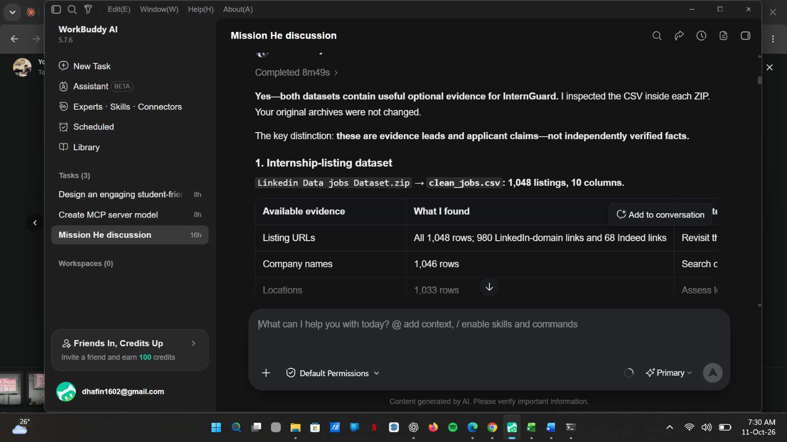
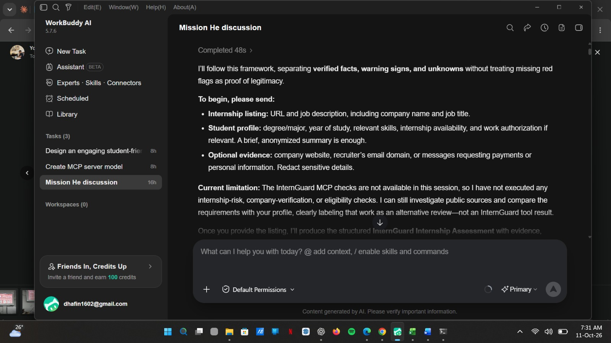
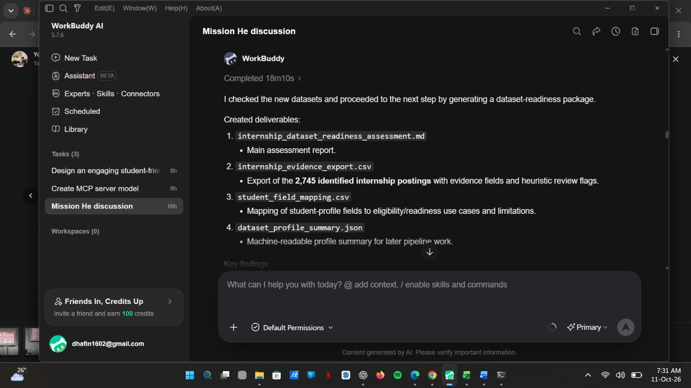
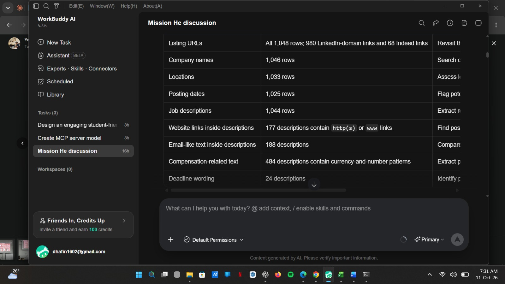
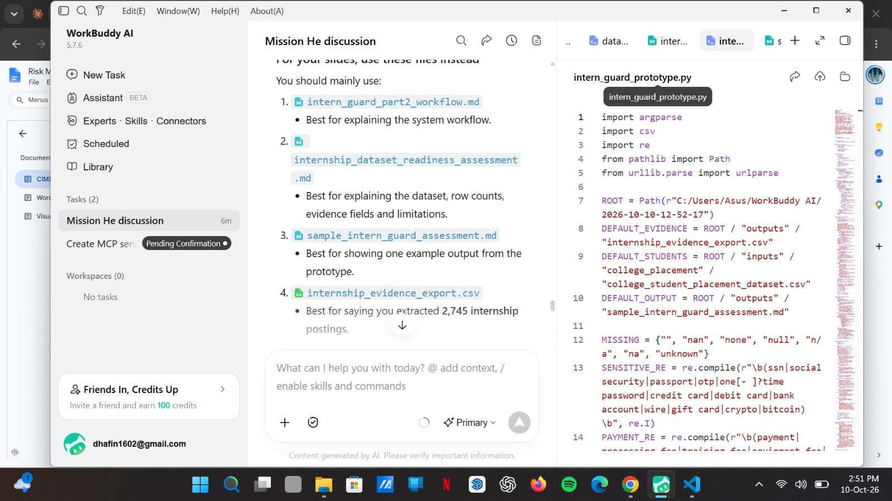

# InternGuard MCP

InternGuard is a local MCP server that helps students check internship postings for scam risk, verify the company behind them, and get an informational read on whether they're eligible to take the internship. It runs as a **stdio** MCP server built on the official [`@modelcontextprotocol/sdk`](https://www.npmjs.com/package/@modelcontextprotocol/sdk). The intended client is WorkBuddy (compatibility to be verified, see below); any stdio MCP client should work.

| Tool | Purpose | Owner | Module |
|---|---|---|---|
| `hello_internguard` | Connection test; reports which modules are live vs. stub | Dev 1 | `src/index.ts` |
| `check_internship_risk` | Scam / safety red flags in a posting | Dev 2 | `src/tools/scam-check.ts` |
| `verify_company` | Is the company real and registered? | Dev 3 | `src/tools/company-check.ts` |
| `check_student_eligibility` | Visa / study / hours eligibility (informational) | Dev 3 | `src/tools/eligibility.ts` |
| (report formatting) | Human-readable output for every tool | Dev 4 | `src/report/formatter.ts` |

---

## Setup

Requirements: **Node.js 22 or newer** (`node --version`), npm, git. No API keys are needed.

```bash
git clone <repo-url> internguard-mcp
cd internguard-mcp
npm install
npm run build
```

### Scripts

| Command | What it does |
|---|---|
| `npm run build` | Clean `dist/` and compile TypeScript |
| `npm run typecheck` | Type-check without emitting (run before every push) |
| `npm run typecheck:watch` | Continuous type-checking while you code |
| `npm run dev` | Run the server from source with `tsx` (no build step) |
| `npm start` | Run the compiled server (`node dist/index.js`), for a quick terminal sanity check only |
| `npm run inspect` | Build, then open MCP Inspector against `dist/` |
| `npm run inspect:dev` | Open MCP Inspector against `src/` via `tsx` |
| `npm run inspect:cli` | Build, then list tools via Inspector's CLI mode (no browser) |
| `npm test` | Run tests in `tests/**/*.test.ts` with Node's built-in test runner |

Running the server directly in a terminal shows only stderr logs and then waits silently for MCP messages. That's normal. Press `Ctrl+C` to stop it.

There is deliberately no file-watch `dev` mode: restarting a stdio server kills the client's connection, so after changing code, rebuild and reconnect the client.

---

## Testing with MCP Inspector

MCP Inspector is the official debugging client. It's fetched on demand by `npx`, so it is not a project dependency.

### Browser UI

```bash
npm run inspect
```

1. The terminal prints a local URL containing an auth token. Open it (it usually opens automatically).
2. Transport should already be **STDIO**, with command `node` and argument `dist/index.js`. Click **Connect**.
3. Open the **Tools** tab, click **List Tools**. You should see all four tools.
4. Select `hello_internguard`, optionally enter a `name`, click **Run Tool**. Expect a success result whose `modules` field shows `"module"` or `"stub"` for each component.
5. Run `check_internship_risk` with any `postingText`. Until Dev 2's module is merged, expect an error result beginning **`TEMPORARY STUB`**.
6. Try an invalid input (e.g. `verify_company` with an empty `companyName`). Expect an input-validation error.
7. Server logs appear in the Inspector's notification/stderr pane, not in tool output.

### CLI mode (scriptable, no browser)

```bash
npm run build
npx -y @modelcontextprotocol/inspector --cli node dist/index.js --method tools/list
npx -y @modelcontextprotocol/inspector --cli node dist/index.js \
  --method tools/call --tool-name hello_internguard --tool-arg name=Team
```

---

## Integrating with WorkBuddy (local stdio)

> **Verification status (updated).**
> - **Config schema: confirmed** from the official [WorkBuddy/CodeBuddy CLI MCP docs](https://www.workbuddy.ai/docs/cli/mcp).
> - **CLI compatibility: tested.** `codebuddy` CLI v2.164.0 registered this server and its health check reported `✓ Connected`, both with and without `env`/`description`.
> - **Still to verify:** a full tool call through a logged-in WorkBuddy session, and the desktop app's config file location (see below).
>
> No WorkBuddy API, SDK or API key is used: WorkBuddy launches this server as a local process and speaks standard MCP over stdio.

### Server entry (official schema)

```jsonc
{
  "mcpServers": {
    "internguard": {
      "type": "stdio",
      "command": "/ABSOLUTE/PATH/TO/node",
      "args": ["/ABSOLUTE/PATH/TO/internguard-mcp/dist/index.js"],
      "env": {
        "INTERNGUARD_LOG_LEVEL": "info",
        "INTERNGUARD_TOOL_TIMEOUT_MS": "30000"
      },
      "description": "InternGuard: internship scam, company and eligibility checks"
    }
  }
}
```

Facts from the official docs that shape this entry:

| Topic | What the docs say | What we do |
|---|---|---|
| Stdio fields | `type`, `command`, `args`, `env`, `defer_loading`, `tools`; `description` appears in examples | Use `type`/`command`/`args`/`env`/`description` |
| `type` | Listed as required for stdio; elsewhere inferred from `command` but explicit is recommended | Always set `"type": "stdio"` |
| `timeout`, `cwd` | Not documented fields | Don't use them; our own timeout is `INTERNGUARD_TOOL_TIMEOUT_MS`, and absolute paths remove the need for `cwd` |
| Format | JSONC (comments and trailing commas allowed) | Plain JSON works too |
| Env expansion | `${VAR}` and `${VAR:-default}` in `command`, `args`, `env` (uppercase names only) | Optional, see "Shareable project config" |
| Output size | Tool output over `MAX_MCP_OUTPUT_TOKENS` (default 20,000 tokens) is written to disk or truncated | Keep reports compact (Dev 4) |
| Tool names | Exposed as `mcp__<server>__<tool>`, e.g. `mcp__internguard__check_internship_risk` | Server name `internguard` |

### Option A: WorkBuddy CLI (`codebuddy`), tested

```bash
npm run build
codebuddy mcp add --scope user internguard -- "$(which node)" "$(pwd)/dist/index.js"
codebuddy mcp list            # expect: internguard: ... - ✓ Connected
codebuddy mcp get internguard
```

This writes the user-scope config (`~/.codebuddy/.mcp.json`). To include `env`, use `add-json` instead:

```bash
codebuddy mcp add-json --scope user internguard \
  "{\"type\":\"stdio\",\"command\":\"$(which node)\",\"args\":[\"$(pwd)/dist/index.js\"],\"env\":{\"INTERNGUARD_LOG_LEVEL\":\"info\"}}"
```

Inside an interactive session, `/mcp` shows server status and config diagnostics. Remove with `codebuddy mcp remove internguard --scope user`.

**Non-interactive smoke test (VERIFY, needs a logged-in account).** Project-scope servers need approval before first use. That approval can't happen in `-p` mode, so pass it via `--settings`:

```bash
codebuddy --settings '{"enabledMcpjsonServers": ["internguard"]}' \
  -p "Call the hello_internguard tool and show me its output."
```

Use this only for a project-scope server; a user-scope server added with Option A doesn't need it.

### Option B: WorkBuddy desktop app (VERIFY)

The official MCP page above documents the CLI, not the desktop app. Third-party connector guides describe the desktop app as **Connections → Custom connections → Configure MCP**, which opens the app's MCP config file in an editor. They disagree on which file that is (`~/.workbuddy/mcp.json`, `~/.workbuddy/.mcp.json`, `$WORKBUDDY_CONFIG_DIR/.mcp.json`).

**Use the Configure MCP button rather than guessing the path.** Then:

1. Merge the server entry above into the file it opens.
2. Save.
3. Confirm `internguard` appears under *My MCP* and its toggle is on. Toggle it off and on if the tools don't refresh.

Record the actual file path here once confirmed: `__________`.

### Tool permissions

WorkBuddy may ask before each tool call. To pre-approve all InternGuard tools (all are read-only), add this to your WorkBuddy settings:

```json
{ "permissions": { "allow": ["mcp__internguard"] } }
```

### Shareable project config (optional, VERIFY)

A project-scope `.mcp.json` at the repo root can be committed and shared, because env-var expansion keeps machine-specific paths out of it. **Not yet tested end to end.** The CLI detects the file, but project-scope servers show `Needs approval` until a user approves them in an interactive session, so the expansion itself couldn't be checked without logging in. Option A is the tested path.

```jsonc
{
  "mcpServers": {
    "internguard": {
      "type": "stdio",
      "command": "${INTERNGUARD_NODE:-node}",
      "args": ["${INTERNGUARD_HOME}/dist/index.js"]
    }
  }
}
```

Each developer then runs `export INTERNGUARD_HOME="$(pwd)"` before launching WorkBuddy. Expansion happens in WorkBuddy's own environment, so this suits the CLI started from a shell. For the desktop app, prefer absolute paths.

### Rules that still apply

- **Get absolute paths first:** `which node` (macOS/Linux) or `(Get-Command node).Source` (Windows). GUI apps often don't inherit your shell `PATH`, especially with nvm.
- **Windows paths in JSON:** escape backslashes (`"C:\\Users\\..."`) or use forward slashes.
- **Never set `command` to `npm`.** `npm start` prints a `> internguard-mcp@0.1.0 start` banner to stdout, which corrupts the MCP stream. Call `node` directly.
- **Set our variables in the config's `env` block, not your shell.** The MCP SDK's stdio client doesn't pass the parent environment to servers by default.

| Variable | Default | Meaning |
|---|---|---|
| `INTERNGUARD_LOG_LEVEL` | `info` | `debug`, `info`, `warn` or `error` (stderr only) |
| `INTERNGUARD_TOOL_TIMEOUT_MS` | `30000` | Per-call timeout for each tool handler |

### Troubleshooting

| Symptom | Likely cause |
|---|---|
| Client says the server exited immediately | Wrong path in `args`, `dist/` not built, or `node` not found (use the absolute path) |
| Handshake / JSON parse error | Something wrote to stdout: an `npm` command, or a `process.stdout.write` in a module |
| A tool always returns `TEMPORARY STUB` | Its module isn't merged, or wasn't rebuilt. Run `npm run build` and reconnect; check stderr for `failed to load` |
| `codebuddy mcp list` shows the server but not ✓ Connected | Run `node dist/index.js` yourself to see the stderr error; check paths |
| WorkBuddy shows tools but asks every time | Add the `mcp__internguard` allow rule above |
| Tool returns "malformed result" | The module's return value doesn't match `ToolResult<T>`; run `npm run typecheck` |

---

## Team contracts (Developers 2, 3, 4: read this)

All shared types live in `src/shared/types.ts`, owned by Dev 1. **Don't edit it**; propose changes in the team channel. Import types with `import type` (the project uses `verbatimModuleSyntax`) and use `.js` extensions in relative imports:

```ts
import type { CheckInternshipRiskHandler } from "../shared/types.js";
```

### How integration works

`src/index.ts` looks for each module at startup. If the file is missing it uses a **TEMPORARY STUB** that returns `status: "error"` with a clear warning. Once your file exists and exports the right name, it's used automatically on the next build. **You never need to edit `index.ts`.** `hello_internguard` reports which modules are live.

`index.ts` also wraps every call: thrown errors, timeouts, and return values that don't match `ToolResult<T>` become a safe `error` result, and are logged to stderr. Input is already validated against the schema before your function is called.

### Exact signatures

Annotate with the handler type so the compiler enforces the contract:

```ts
// src/tools/scam-check.ts  (Developer 2)
import type { CheckInternshipRiskHandler } from "../shared/types.js";
export const checkInternshipRisk: CheckInternshipRiskHandler = async (input) => { /* ... */ };
// (input: CheckInternshipRiskInput) => Promise<ToolResult<InternshipRiskData>>

// src/tools/company-check.ts  (Developer 3)
import type { VerifyCompanyHandler } from "../shared/types.js";
export const verifyCompany: VerifyCompanyHandler = async (input) => { /* ... */ };
// (input: VerifyCompanyInput) => Promise<ToolResult<CompanyVerificationData>>

// src/tools/eligibility.ts  (Developer 3)
import type { CheckStudentEligibilityHandler } from "../shared/types.js";
export const checkStudentEligibility: CheckStudentEligibilityHandler = async (input) => { /* ... */ };
// (input: CheckStudentEligibilityInput) => Promise<ToolResult<StudentEligibilityData>>

// src/report/formatter.ts  (Developer 4)
import type { FormatReportFn } from "../shared/types.js";
export const formatReport: FormatReportFn = (toolName, result) => { /* ... */ return ""; };
// (toolName: InternGuardToolName, result: ToolResult<unknown>) => string   (synchronous, must not throw)
```

The export names (`checkInternshipRisk`, `verifyCompany`, `checkStudentEligibility`, `formatReport`) and file paths are part of the contract.

### `ToolResult<T>` rules

- `success`: `data` is fully populated.
- `partial`: `data` holds what is known; `warnings` explains what's missing (e.g. a source timed out).
- `error`: `data` is `null`; `warnings` has at least one human-readable reason.
- `evidence[].source` is a URL, a registry name, or `"posting_text"` for the user's own input.
- Prefer returning `error`/`partial` over throwing; never fabricate evidence.

### Rules for every module

1. **Never write to stdout.** No `process.stdout.write`. Use `console.error` for logs (`console.log` is redirected to stderr as a safety net, but don't rely on it).
2. No top-level side effects (network calls, timers) at import time. Do work inside the exported function.
3. Respect the timeout (default 30 s); use `AbortController` with `fetch`.
4. No secrets in code. Discuss any new dependency with Dev 1 first (Dev 1 owns `package.json`).
5. Run `npm run typecheck && npm run build` before pushing.

### Output size (Developer 4)

WorkBuddy writes tool output over 20,000 tokens to disk or truncates it. Keep `formatReport` output well under that: aim for a few KB, and summarise long evidence lists rather than dumping them.

### Testing (Developer 4)

`src/index.ts` exports `createInternGuardServer(deps)` and `loadDependencies()`, and does **not** start the stdio server when imported. That lets tests exercise the full MCP path in-process:

```ts
import { Client } from "@modelcontextprotocol/sdk/client/index.js";
import { InMemoryTransport } from "@modelcontextprotocol/sdk/inMemory.js";
import { createInternGuardServer, loadDependencies } from "../src/index.js";

const server = createInternGuardServer(await loadDependencies());
const [clientT, serverT] = InMemoryTransport.createLinkedPair();
await server.connect(serverT);
const client = new Client({ name: "test", version: "0" });
await client.connect(clientT);
const res = await client.callTool({ name: "hello_internguard", arguments: {} });
```

Unit tests can also import a handler directly, or pass fake handlers into `createInternGuardServer`.

---

## Execution layer: investigate → shortlist → prepare → approve → export → track

InternGuard investigates up to 10 listings, shortlists up to 3, prepares application packages, waits for the **student's** approval in a local web page, exports real files and tracks every application in SQLite. It never submits applications, sends email or automates job sites.

```
WorkBuddy (plans, reasons, writes the texts)
   │  MCP over stdio
   ▼
InternGuard MCP server (dist/index.js)
   ├─ check_internship_risk ─┐
   ├─ verify_company ────────┼─ each call is stored → investigationId
   ├─ check_student_eligibility ┘
   ├─ shortlist_internships     takes investigationIds only; loads stored results
   ├─ prepare_application_pack  validates text against stored evidence; hashes it
   ├─ save_approved_application exports ONLY if the student approved this exact hash
   └─ get_application_tracker   statuses, approvals, files re-verified on disk
         │                         ▲
         ▼  data/internguard.db    │ same database (WAL)
Approval interface (npm run approval) ── the only place a package can be approved
         http://127.0.0.1:4317, login link printed to the student's terminal
```

**Why investigation IDs.** `shortlist_internships` never accepts scam, company or eligibility results from the agent. It loads them from the database and checks that each belongs to its listing (same URL, company and student profile). The model cannot invent or edit a verification result on its way into the shortlist.

### Application states

| State | Meaning | Set by |
|---|---|---|
| `PREPARED` | Package stored | `prepare_application_pack` |
| `AWAITING_APPROVAL` | Waiting for the student | `prepare_application_pack` (also after any change) |
| `REJECTED_BY_STUDENT` | Student rejected this version | Approval page |
| `READY_TO_SUBMIT` | Student approved this exact content hash | Approval page |
| `MANUAL_ACTION_REQUIRED` | Files exported and verified; the student must submit at the apply link | `save_approved_application` |
| `SUBMITTED` | Student confirmed submission **and entered evidence** (confirmation number/reference) | Approval page only |

There is no tool or parameter that approves or marks anything submitted.

### Approval design

- Separate process started by the student, bound to `127.0.0.1` only.
- Login requires a random token printed **only** to the student's terminal; nothing about it passes through MCP.
- HttpOnly + SameSite=Strict session cookie, per-session CSRF token, `Host`/`Origin` checks (DNS rebinding and cross-site requests are refused).
- Each decision carries the content hash that was displayed; it is refused if the package changed. A changed package becomes a new version that needs a new approval.
- Before exporting, the server recomputes the hash from the stored content (detects database tampering) and checks the approval matches.
- **Limitation:** any program running as the same OS user with unrestricted shell access could read the terminal or edit the database. Do not give the agent shell or local-network access during the workflow (see WorkBuddy permissions below).

### Anti-fabrication rules (`prepare_application_pack`)

Refused outright (nothing stored): a referenced skill not in the student's profile; an email address or link not present in the listing, the company verification result or the student's own details; a recruiter `to` address not in the listing. Flagged for the student on the approval page: placeholders, unlisted phone numbers, requirement skills mentioned that the student does not have, missing company or student name.

### Commands

```bash
npm install                 # better-sqlite3 12.11.1: downloads a prebuilt binary, no compiler needed
npm run build
npm test                    # 99 tests, incl. full end-to-end flow
npm run approval            # student's approval interface (prints login link)
npm run demo:prepare        # scripted demo: 7 SIMULATED listings → 3 packages
npm run demo:execute        # after approving: export + tracker
npm run demo:status         # tracker only
```

| Variable | Default | Purpose |
|---|---|---|
| `INTERNGUARD_DATA_DIR` | `<repo>/data` | SQLite database location |
| `INTERNGUARD_EXPORTS_DIR` | `<repo>/exports` | Exported application folders |
| `INTERNGUARD_APPROVAL_PORT` | `4317` | Approval interface port |
| `INTERNGUARD_NO_BROWSER` | unset | Set to `1` to stop `npm run approval` opening the login link in your browser |
| `INTERNGUARD_COMPANY_SOURCES` | unset | Set to `gleif` to check companies against the real GLEIF LEI register (free, no API key; sends only the company name and country to api.gleif.org) |
| `INTERNGUARD_SIMULATED_REGISTRY` | unset | Path to a **simulated** registry fixture (demo only). Unset = company checks are `inconclusive`. |

The MCP server and the approval interface must use the same `INTERNGUARD_DATA_DIR`. Paths default to the repo, regardless of the directory WorkBuddy starts the server from.

### Company verification with real data

| Source | How it is used | Notes |
|---|---|---|
| **GLEIF LEI register** | Automatic, when `INTERNGUARD_COMPANY_SOURCES=gleif` | Free, no API key. Covers companies that hold an LEI: mostly banks, listed and larger companies. Only an exact (normalised) name match counts; GLEIF's search also returns partial matches. |
| **SSM** (Malaysia's official register) | Manual, recommended to the student | SSM e-Info, MyDATA SSM and SSM Search are paid and need an account; there is no free public API. |
| Simulated fixture | Demo only, when `INTERNGUARD_SIMULATED_REGISTRY` is set | Fictional companies, always labelled SIMULATED. |

A company that is **not found** in these sources is reported as `inconclusive`, never `not_found`: most small companies have no LEI, and the demo fixture holds only four fictional companies. `verified` means an exact match to an ACTIVE entity; `unverified` means a conflict (inactive entity, different registration number or website).

Test one company against GLEIF directly (no WorkBuddy needed):

```cmd
npm run check:company -- "Malayan Banking Berhad" Malaysia
```

For WorkBuddy, set `"INTERNGUARD_COMPANY_SOURCES": "gleif"` in the connector's `env`, and remove `INTERNGUARD_SIMULATED_REGISTRY` unless you are running the scripted demo.

### Troubleshooting `npm install` (better-sqlite3)

`better-sqlite3` is pinned to **12.11.1** on purpose: it ships prebuilt binaries for Windows, macOS and Linux on Node 22, 24 and newer. **Do not upgrade it to 13.x**: 13.x has no prebuilt binaries and always compiles from source, which on Windows needs Visual Studio C++ Build Tools.

If you see `gyp ERR! find VS` or `node-gyp rebuild` errors:

```powershell
# Windows PowerShell, in the project folder
Remove-Item -Recurse -Force node_modules
npm ci
```

If it still tries to compile, the binary download from GitHub was blocked (proxy, firewall or antivirus). Either retry on another network, or install "Desktop development with C++" from Visual Studio Build Tools (several GB).

### Scripted demo (no WorkBuddy needed)

```bash
npm run demo:prepare        # terminal 1
npm run approval            # terminal 2: open the printed login link, approve the 3 packages
npm run demo:execute        # terminal 1
```

Expected: L1–L3 shortlisted; L4 rejected (registration fee); L5 rejected (Telegram task scam); L6 rejected (needs 40 h/week on-site, student offers 25 h hybrid); L7 insufficient evidence (listing not accessible). After approval: 3 folders × 5 files in `exports/`, all `MANUAL_ACTION_REQUIRED`, files verified by SHA-256. Running `demo:execute` again exports nothing new. All demo data is fictional and labelled SIMULATED.

### Testing the new tools in MCP Inspector

```bash
INTERNGUARD_SIMULATED_REGISTRY=fixtures/demo/company-registry.simulated.json npm run inspect
```

1. Call `check_internship_risk` with `postingText` and `postingUrl` from `fixtures/demo/listings.simulated.json` (L1). Copy the `investigationId` from the result.
2. Call `verify_company` (`companyName`, `website`) and `check_student_eligibility` (with `student` and `requirements` from the fixtures). Copy both ids.
3. Call `shortlist_internships` with the student profile and one listing that references the three ids. Copy the `caseId`.
4. Call `prepare_application_pack` with that `caseId` and `fixtures/demo/application-content.simulated.json` → `packs.L1`. Note the `reviewUrl`.
5. Call `save_approved_application` with the `packageId`: it must be **refused** (no approval).
6. Run `npm run approval`, open the login link, approve, then repeat step 5: files are exported.
7. Call `get_application_tracker`. Prompts tab → `investigate_and_prepare` shows the orchestration playbook.

### WorkBuddy integration for the execution layer

The connector entry stays the same stdio command; add the environment block:

```jsonc
{
  "mcpServers": {
    "internguard": {
      "type": "stdio",
      "command": "/ABSOLUTE/PATH/TO/node",
      "args": ["/ABSOLUTE/PATH/TO/internguard-mcp/dist/index.js"],
      "env": {
        "INTERNGUARD_DATA_DIR": "/ABSOLUTE/PATH/TO/internguard-mcp/data",
        "INTERNGUARD_EXPORTS_DIR": "/ABSOLUTE/PATH/TO/internguard-mcp/exports",
        // demo only; remove for real use:
        "INTERNGUARD_SIMULATED_REGISTRY": "/ABSOLUTE/PATH/TO/internguard-mcp/fixtures/demo/company-registry.simulated.json"
      }
    }
  }
}
```

Demo prompt for WorkBuddy (after `npm run approval` is running in the student's terminal):

> Call get_workflow_playbook and follow it exactly. My profile is in fixtures/demo/student.simulated.json and the 7 listings (with their text) are in fixtures/demo/listings.simulated.json. Investigate all seven, shortlist up to three, prepare an application package for each, and give me the review links. I will approve them myself.

Capabilities that depend on WorkBuddy and must be tested on the demo machine:

| Dependency | Status | How to test / fallback |
|---|---|---|
| Stdio MCP connection | **Tested** with `codebuddy` CLI v2.164.0 (`✓ Connected`, 8 tools) | `codebuddy mcp list` |
| MCP prompt as slash command | **Tested by the team:** does not appear in the WorkBuddy desktop app (documented for the CLI only) | Use the `get_workflow_playbook` tool instead: ask WorkBuddy to call it first |
| Fetching listing URLs | **Tested by the team:** WorkBuddy has a web-fetch tool, but LinkedIn returns empty content (login required). WorkBuddy then tried browser automation, which the playbook now forbids | Student pastes the text; mark `provided_by_student`; use the clean URL (no tracking parameters) in every call |
| Browser automation by the agent | WorkBuddy reached for a browser tool on its own | **Deny browser tools during the workflow.** A browser sharing the student's profile could use the approval session cookie and approve packages itself |
| ~25 tool calls in one task | Untested | Run the demo prompt. Tools are idempotent, so "continue" is safe |
| Tool output size | Largest response ≈ 3k tokens for 7 listings (limit 20k) | Measured locally |
| Preventing the agent from using the approval page | Approval needs a terminal-only token; WorkBuddy's shell/web tools could still reach localhost | Deny shell and web-fetch tools during the demo via WorkBuddy permission rules (VERIFY rule names in WorkBuddy's permissions docs) |

### File ownership (parallel work without merge conflicts)

| Developer | Owns |
|---|---|
| 1: MCP core & integration | `src/index.ts`, `src/shared/types.ts`, `src/execution/register.ts`, `scripts/*`, `tests/execution-e2e.test.ts`, `package.json`, `tsconfig.json`, `README.md` |
| 2: scam detection & shortlisting | `src/tools/scam-check.ts`, `src/tools/shortlist.ts`, `tests/scam-check.test.ts`, `tests/shortlist.test.ts`, `examples/scam-cases.json` |
| 3: company verification & eligibility | `src/tools/company-check.ts`, `src/tools/eligibility.ts`, `tests/company-eligibility.test.ts`, `fixtures/demo/company-registry.simulated.json` |
| 4: packages, persistence, approval, export, tracking | `src/execution/{paths,db,store,pack,exporter,tracker}.ts`, `src/approval/*`, `src/report/formatter.ts`, `tests/execution-units.test.ts`, `tests/formatter.test.ts`, `fixtures/demo/application-content.simulated.json` |

Shared contracts are in `src/shared/types.ts` (Developer 1). Changing a type there is announced to the team first; the zod schemas in `index.ts` and `register.ts` fail to compile if they drift from it.

## Work Buddy Screenshot






---

## Project structure

```
internguard-mcp/
├── src/
│   ├── index.ts                  # MCP server, investigation tools, persistence of results
│   ├── shared/types.ts           # shared contracts
│   ├── tools/                    # scam-check, shortlist, company-check, eligibility
│   ├── execution/                # register, paths, db, store, pack, exporter, tracker
│   ├── approval/                 # local approval interface (server.ts, cli.ts)
│   └── report/formatter.ts       # (Developer 4) readable reports for all 8 tools
├── scripts/                      # demo.ts, demo-flow.ts
├── fixtures/demo/                # SIMULATED student, listings, registry, package texts
├── tests/
├── data/      (gitignored)       # SQLite database
└── exports/   (gitignored)       # one folder per approved application
```

<!-- Sections below are owned by other developers. -->

## Tool details

_TODO (Devs 2 and 3): describe detection rules, data sources and known limitations._

## Testing details

_TODO (Dev 4)._

## Disclaimer

InternGuard's results are informational. They are not legal, immigration or employment advice; students should confirm with their institution and official government sources.
